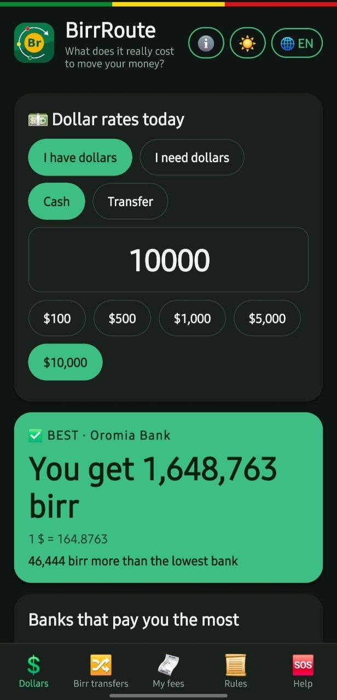
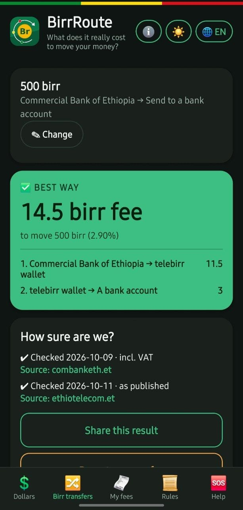
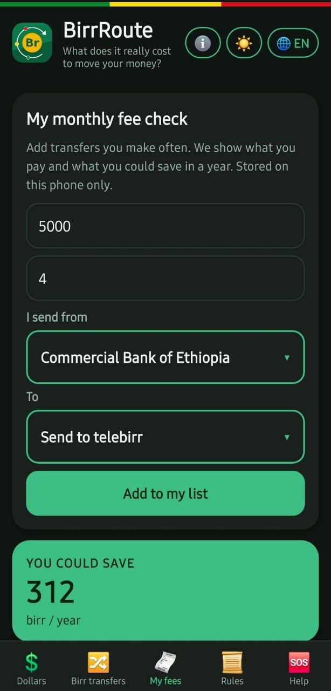
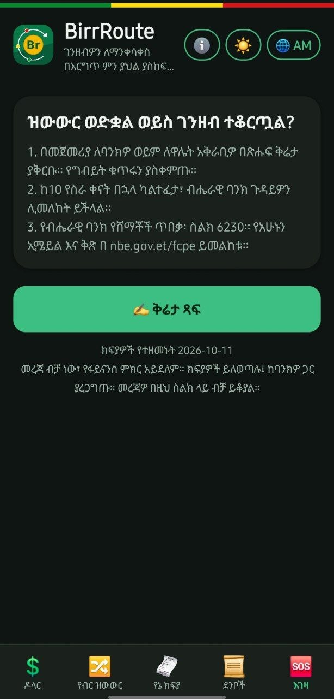

<p align="center">
  
</p>

<h1 align="center">BirrRoute</h1>

<p align="center"><b>Find the best bank for your dollars and the cheapest way to move birr in Ethiopia.</b></p>

<p align="center">
  <a href="https://github.com/arsema-hm/birrroute/releases">⬇ Download the Android app</a>
</p>

<p align="center">
  
  
  
  
</p>

## What it does

- **Dollars (main feature):** "I have dollars" ranks banks by what they pay you. "I need dollars" ranks banks by total cost, including the NBE 4% fee cap. Cash and transfer rates are kept apart, because comparing them is unfair.
- **Birr transfers:** answers three questions and gives one answer: the cheapest way to get cash or send money across banks, telebirr and CBE Birr, with the fee for every step and its source.
- **My fees:** add the transfers you make every month and see how much you could save in a year. Stored on the phone only.
- **Rules:** see what an NBE foreign-exchange rule said on any date, and what changed since.
- **Help:** steps for a failed transfer, a complaint writer, and a saved case tracker.
- Five languages (English, Amharic, Afaan Oromoo, Tigrinya, Somali), light and dark mode, and no account needed.

## Why you can trust the numbers

- Bank dollar rates load live, each with its own date. Banks that have not updated today are listed apart.
- Any rate far from the official NBE rate, or where you would "get" more than you "pay", is left out and shown as a warning.
- Every fee comes from the bank's own tariff page, with the date it was checked and a link. A fee that has not been re-checked for 45 days triggers a visible warning.
- Fees are re-verified every month. See [RELEASE.md](RELEASE.md).

## Built with

React Native (Expo) and JavaScript, with AsyncStorage for on-phone data and EAS Build for the Android app. The fee, rate and rules logic is plain JavaScript in `core/`, covered by 45 automated tests.

## Run it yourself

```
git clone https://github.com/arsema-hm/birrroute.git
cd birrroute
npm install
npx expo start
```

Open the QR code with Expo Go on your phone. To run the logic tests: `cd core && npm test`.

## Data and credits

- Live bank dollar rates: [ET-Forex](https://et-forex.com) public API (credited in the app).
- Official NBE rate: [AllRatesToday](https://allratestoday.com/central-bank-rates-api/nbe/).
- Fees: CBE, Bank of Abyssinia, Siinqee, Amhara Bank, Dashen and telebirr, from their own pages. Other banks show "fees not added yet".
- Details and terms: [DATA_SOURCES.md](DATA_SOURCES.md).

## Honest limits

- Live rates depend on a third-party API (free in preview). If it fails, the app shows the last saved rates with their time.
- Transfer fees are verified for six providers only. Awash is left out until its current tariff is clear.
- Translations are drafts that still need native-speaker review. Rule summaries are in English.
- There are no push alerts. The rate watch checks when you open the app.
- Android test build only so far. Information only, not financial advice. Always confirm the rate and fee with your bank.

## License

MIT
